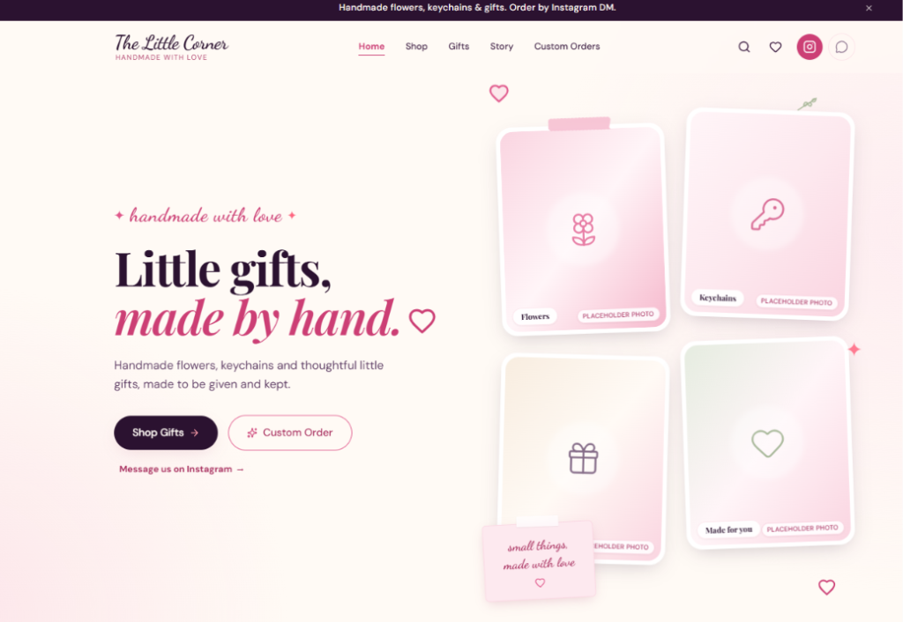
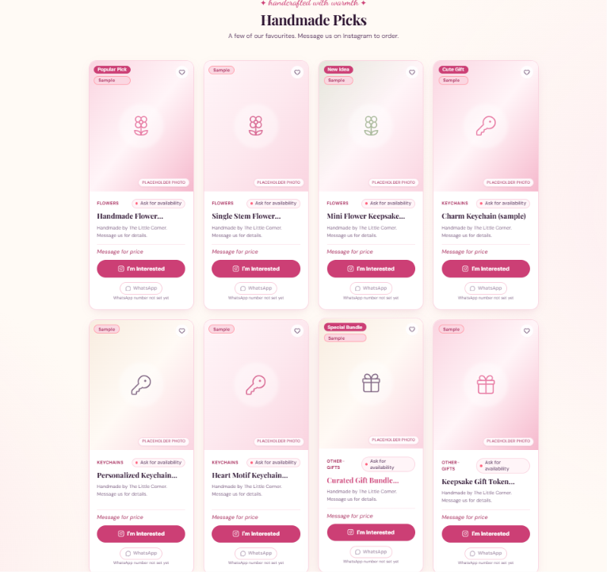
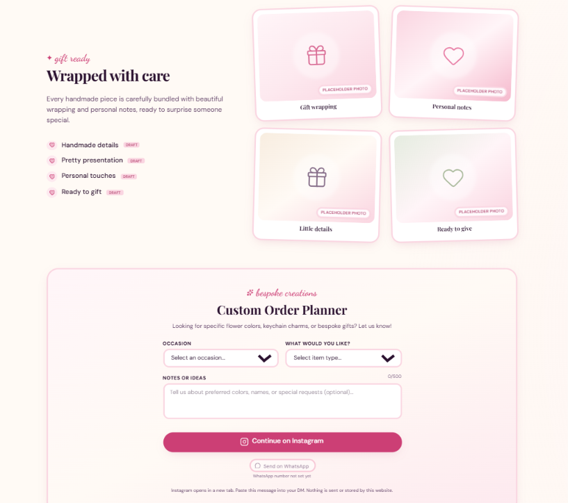

# The Little Corner — Handmade Gifts & Crafts Brand Website

A warm, responsive, and accessible brand website for **The Little Corner**, handcrafted with love for delicate eternal flowers, customized charm keychains, and keepsake gift bundles.

The design is inspired by the visual scrapbook charm and soft aesthetic of the GiftVerse design reference (soft blush tones, polaroid collage cards, script handwriting accents, washi tape styling, and floating heart doodles), purpose-built to showcase genuine handmade crafts with direct-to-maker Instagram DM inquiries and optional WhatsApp support.

---

## 📸 Website Preview

### 🎀 Homepage & Scrapbook Hero


### 🌸 Handmade Picks & "I'm Interested" Product Actions


### ✨ Packaging Showcase & Bespoke Custom Order Planner


---

## 🌸 Tech Stack & Design System

- **Framework**: React 18+ with Vite (JavaScript)
- **Styling**: Tailwind CSS v4 using `@tailwindcss/vite` and modern `@theme` design tokens
- **Icons**: [Lucide React](https://lucide.dev) + custom accessible SVG brand icons & doodles
- **Routing**: [React Router DOM v6](https://reactrouter.com)
- **SEO & Social Cards**: [react-helmet-async](https://github.com/staylor/react-helmet-async) with OpenGraph and JSON-LD schema
- **Smooth Scrolling**: [Lenis](https://lenis.darkroom.engineering) with prefers-reduced-motion accessibility support
- **Testing**: [Vitest](https://vitest.dev) + [React Testing Library](https://testing-library.com) + `@testing-library/jest-dom`
- **Typography** (Google Fonts):
  - *Serif*: **Playfair Display** (Headings, titles, price accents)
  - *Script*: **Dancing Script** (Eyebrows, handwritten sticky notes)
  - *Sans*: **DM Sans** (Body copy, buttons, labels)
- **Design Tokens**:
  - `ivory`: `#FFFAF5`
  - `blush`: `#FFF5F8`, `#FDE9EF`, `#FAD5E1`, `#F5B9CD`, `#EE94B1`
  - `rose`: `#E0568A`, `#CC3F75`, `#A8305F`
  - `plum`: `#2B1230`, `#3A1B40`, `#5B3B62`, `#84698A`
  - `cream`: `#F8EDE0`, `leaf`: `#BFD0B2`, `#8FA67E`

---

## 📱 Contact & Order Configuration

### Instagram (Primary Order Channel)
- **Handle**: `thelittlecornerbytasbiii`
- **Profile URL**: `https://www.instagram.com/thelittlecornerbytasbiii/`
- **DM URL**: `https://ig.me/m/thelittlecornerbytasbiii`

#### Rationale for Copy-Message Workflow & "I'm Interested" Inquiries
Unlike WhatsApp's `wa.me/?text=` parameter, `ig.me/m/<username>` deep-links do not reliably support URL query parameters for pre-filled chat messages across different devices.
To provide an effortless, transparent experience for customers:
1. When a customer clicks **"I'm Interested"** on any product card, the browser opens the direct DM link in a new tab (`https://ig.me/m/thelittlecornerbytasbiii?text=...` as a best-effort prefill).
2. Concurrently, the card reveals a compact **Inquiry Panel** displaying the pre-formatted inquiry message with the product's exact name and a one-click **"Copy message"** button.
3. The customer simply pastes the pre-formatted text into their Instagram DM with the maker.
4. **Non-negotiable copy rule**: The website never claims a message was "sent" or "submitted" automatically. UI wording always transparently states: *"Instagram will open in a new tab. Paste this message into your DM and review it before sending."*

#### Instagram Deep-Link Limitations
- **Ignored query parameters**: `ig.me/m/<username>` reliably opens the Instagram DM thread, but may ignore `?text=` query parameters on various mobile operating system versions and native app releases.
- **Guaranteed fallback**: The inline copy-message panel is the guaranteed fallback across all platforms, ensuring customers always have the exact inquiry text copied or ready to copy with one tap.
- **Client & device variance**: Behavior differs between the native Instagram mobile app, desktop web browsers, and logged-out users (who are directed to log in to Instagram first).
- **No transmission telemetry**: The website operates with zero backend and Rs 0 budget; it cannot and does not track or detect whether a message was actually sent. The user reviews and sends the message themselves.

### WhatsApp (Secondary Optional Channel)
- **Current State**: Unconfigured (`whatsappNumber: ""` in `src/config/site.js`).
- All WhatsApp buttons gracefully degrade to a disabled state displaying the caption `"WhatsApp number not set yet"`. No broken `wa.me` links or invented numbers are ever rendered.
- **When the owner is ready to enable WhatsApp**:
  1. Open `src/config/site.js`.
  2. Set `whatsappNumber` to digits only with country code (no `+`, spaces, or hyphens), e.g.:
     ```javascript
     whatsappNumber: "919876543210", // TODO: replace with owner's international digits
     ```
  3. All WhatsApp buttons across the Header, Product cards, Drawer, and Footer will immediately activate, generating `https://wa.me/<number>?text=<encoded_inquiry>` links.

---

## 🚀 Getting Started

### 1. Install Dependencies
```bash
npm install
```

### 2. Run Development Server
```bash
npm run dev
```
In development mode, a small dismissible **Launch Checklist** badge appears pinned to the bottom-left corner of the screen, listing any unconfigured business details (automatically hidden in production builds).

### 3. Run Unit and Component Tests
```bash
npm test
```

### 4. Run Linter
```bash
npm run lint
```

### 5. Build for Production
```bash
npm run build
```

### 6. Preview Production Build
```bash
npm run preview
```

---

## 📋 Replace Before Launch Checklist

Before making the website live for real customers, review and replace remaining placeholder data:

| Item | File Location | What to Provide | Status |
| :--- | :--- | :--- | :--- |
| **Instagram DM & Profile** | `src/config/site.js` | Configured to `@thelittlecornerbytasbiii` | ✅ Configured |
| **WhatsApp Number** | `src/config/site.js` (`whatsappNumber`) | International digits with country code (e.g. `"919876543210"`). Enables secondary WhatsApp inquiry buttons. | ⏳ Optional (currently empty) |
| **Logo** | `src/components/layout/Logo.jsx` | Drop your transparent logo image in `/public/images/logo.png` and uncomment the `` slot. | ⏳ To supply |
| **Real Product Photos** | `/public/images/products/` & `src/data/products.js` | 16 genuine handmade craft photos configured with custom focal positioning. | ✅ 16 Photos Live |
| **Names & Descriptions**| `src/data/products.js` | 16 authentic products configured across Flowers, Keychains, and Gifts. | ✅ 16 Items Live |
| **Product Prices** | `src/data/products.js` (`price`) | Replace `null` with actual numeric values (e.g. `199`). If `null`, shows *"Message for price"*. | ⏳ Ready to set |
| **Availability** | `src/data/products.js` (`availability`)| Change from `"ask"` to `"available"`, `"limited"`, or `"sold-out"`. | ⏳ Configured as "ask" |
| **Brand Copy & Story** | `src/config/content.js` | Review and personalize the draft brand story, checklist, and process steps. | ⏳ To review |
| **FAQs** | `src/config/content.js` (`faqs`) | Fill in official answers for order turnaround, shipping locations, and payment details. | ⏳ To review |
| **Policies** | `src/config/content.js` (`policies`) | Update Shipping & Delivery, Returns, and Privacy terms. | ⏳ To review |
| **Canonical URL** | `src/config/site.js` (`siteUrl`) | Production domain deployed on Vercel for SEO tags, canonical link, and sitemap. | ✅ Configured (`https://the-littlecorner.vercel.app`) |
| **Open Graph Card** | `/public/og-placeholder.svg` | Replace with a high-resolution 1200x630px social share banner `/public/og-image.jpg`. | ⏳ To supply |
| **Mobile Phone Test** | Real Device | Test tapping "I'm Interested" on both iOS and Android to confirm the Instagram app/web DM opens and clipboard paste works smoothly. | ⏳ To test |

---

## 📸 Product Photography & Originality Standard

> [!IMPORTANT]
> **Every product photograph displayed on this website must be the shop's own original work.**
> Do not use stock photography, external Pinterest reposts without ownership, or images of items not crafted by The Little Corner.

All product photographs are stored in `/public/images/products/` and are presented in a clean `4:5` aspect ratio card with smooth skeleton loading and custom focal alignment.

---

## 🛍️ How to Add or Edit a Product

Every item in the store catalog is defined in `src/data/products.js`.

### Product Schema

```javascript
{
  id: "pink-tulip-bouquet",
  slug: "pink-tulip-bouquet",
  name: "Pink Tulip Bouquet",
  category: "flowers", // "flowers" | "keychains" | "other-gifts"
  shortDescription: "Handmade by The Little Corner. Message us for details.",
  price: null, // number (e.g. 199) or null for "Message for price"
  availability: "ask", // "available" | "limited" | "sold-out" | "ask"
  badge: null, // optional string badge like "Bestseller" or "New", or null
  featured: true, // true to display in the Homepage featured grid (up to 8 items)
  isPlaceholder: false, // set false for real products (hides "Sample" / placeholder markers)
  image: {
    src: "/images/products/pink-tulip-bouquet.jpg",
    alt: "A single fuzzy pink tulip with green leaves, wrapped in blush paper",
    placeholderTone: "blush", // "blush" | "rose" | "cream" | "leaf"
    objectPosition: "center 30%", // CSS object-position for custom vertical/horizontal focal crop
  },
}
```

### Adding Prices
- Set `price: 199` (a standard number without quotes or currency signs).
- The currency symbol and locale formatting are automatically applied based on `siteConfig.currency` (configured in `src/config/site.js`, e.g. `₹` INR).
- Leaving `price: null` gracefully renders the `"Message for price"` badge and copy, prompting customers to inquire via DM.

### Image Focal Positioning
- Since cards maintain a consistent `4:5` aspect ratio across all screen sizes, use `image.objectPosition` (e.g. `"center 30%"` or `"center top"`) to ensure the key subject of tall or wide photos remains perfectly centered.

The product will automatically appear in:
- The Home page featured grid (if `featured: true`)
- The `/shop` collection catalog with real-time category filtering and search
- The quick search dialog accessible from the top navigation bar

---

## ✍️ Draft Copy Locations

All text across the entire website is centralized in two readable configuration files:

1. **`src/config/site.js`**:
   - `brandName`: Store brand title
   - `tagline`: Header and hero eyebrow subtitle
   - `announcement`: Header top banner text and enabled toggle
   - `trustItems`: The 4 benefits bar cards (Handmade, Made with care, Personal touches, Order on Instagram)

2. **`src/config/content.js`**:
   - `hero`: Eyebrow, serif headline lines, supporting paragraph, and CTA button labels
   - `featuredProducts`: Section heading and view all label
   - `story`: The 3-step handcrafted ordering process and brand narrative
   - `packaging`: The 4-point packaging care checklist and showcase captions
   - `customOrder`: Bespoke inquiry form labels, occasions, and Instagram DM instructions
   - `instagram`: Gallery header and community caption
   - `followBand`: Social connect and Instagram order callout
   - `footer`: Category links, customer care links, and brand synopsis
   - `faqs`: Accordion question items and responses
   - `policies`: Shipping, Returns, and Privacy policy statements

---

## ♿ Accessibility & Design Decisions

- **Color Contrast**: Maintained WCAG AA compliance across all components with deep aubergine (`plum-700` and `plum-950`) on `ivory` and `blush` backgrounds, and `rose-700` for smaller text elements.
- **Focus Indicators**: Distinct `outline: 2px solid #CC3F75` with `2px offset` on all interactive links, buttons, and form inputs.
- **Screen Reader Support**: Skip-to-content shortcut, semantic HTML landmarks (`<header>`, `<nav>`, `<main>`, `<footer>`), `aria-expanded` and `aria-controls` for accordions, `aria-pressed` for heart toggles and category filters, and polite `aria-live` announcements for search result counts.
- **Graceful Degradation**: Zero crashes when WhatsApp number or Instagram link is unconfigured; action buttons present informative disabled tooltips and guidance notices without breaking UI layouts.
- **Reduced Motion**: Respects `prefers-reduced-motion` media queries by disabling floating animations and hover shifts.
